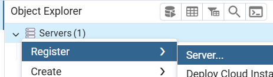
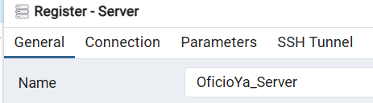
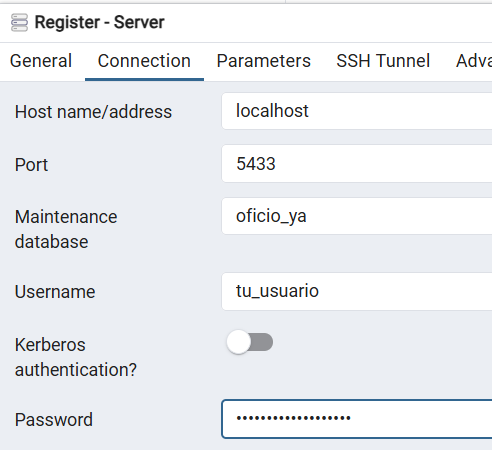
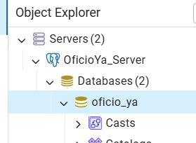

# OficioYa Backend

API de OficioYa construida con Django + Django REST Framework.

## Requisitos

- Git
- [Docker Desktop](https://www.docker.com/products/docker-desktop/ "Instalar Docker Desktop") (recomendado para correr todo local)
- (Opcional) [Python 3.13](https://www.python.org/downloads/) + [`uv`](https://docs.astral.sh/uv/getting-started/installation/ "Instalar uv") para ejecución sin Docker

## 1) Clonar el repositorio

```bash
git clone https://github.com/brianrscode/OficioYa.git
```
### 1.1) Entrar al directorio

```bash
cd OficioYa/backend
```

## 2) Configurar variables de entorno

Crea el archivo `.env` en la carpeta `backend`.

Ejemplo mínimo para desarrollo local:

```env
DEBUG=True
SECRET_KEY=tu_clave_secreta

ALLOWED_HOSTS=localhost,127.0.0.1
ALLOWED_HOSTS_DEBUG=*

NAME_BD=oficio_ya
USER_BD=admin_oficio
PASSWORD_BD=tu_password
HOST_BD=localhost
PORT_BD=5432

# Opcional en local con DEBUG=True
DATABASE_URL=

# Si usas Cloudinary
CLOUDINARY_CLOUD_NAME=
CLOUDINARY_API_KEY=
CLOUDINARY_API_SECRET=
```

## 3) Levantar la aplicación con Docker (recomendado)

Desde la carpeta `backend`:

```bash
docker compose up --build
```

Esto levanta:

- `db` (PostgreSQL)
- `backend` (Django en `http://127.0.0.1:8000`)

El contenedor backend espera a que PostgreSQL esté disponible y ejecuta migraciones automáticamente.

### 3.1) ¿Cuándo usar `--build`?

Usa `docker compose up --build` cuando cambies algo que afecta la imagen del contenedor, por ejemplo:

- `Dockerfile`
- `pyproject.toml` o `uv.lock`
- código del backend (porque el proyecto se copia dentro de la imagen)

Si no hiciste esos cambios y solo quieres volver a levantar servicios, usa:

```bash
docker compose up
```

Para trabajo diario, también puedes usar segundo plano:

```bash
docker compose up -d
docker compose up -d --build
```

## 4) Verificar que funciona

- API base: `http://127.0.0.1:8000/`
- Admin Django: `http://127.0.0.1:8000/admin/`
- Swagger (solo en debug): `http://127.0.0.1:8000/api/schema/swagger-ui/`

## 5) Comandos útiles

```bash
# Ver logs
docker compose logs -f

# Ejecutar en segundo plano
docker compose up -d

# Ejecutar en segundo plano reconstruyendo imagen
docker compose up -d --build

# Detener contenedores
docker compose down

# Detener y borrar volúmenes (reinicia base de datos)
docker compose down -v
```

## 6) Flujo recomendado con script `run`

- Para evitar errores al escribir comandos largos, usa los atajos del script `run`.
- En Windows PowerShell, puedes usar `bash run <comando>`.
- No es necesario detener los contenedores para ejecutar comandos de Django. En otra terminal puedes correr:

```bash
# Levantar servicios
./run up-build

# Crear y aplicar migraciones
./run runmigrations
./run migrate

# Crear superusuario
./run superuser

# Ver logs
./run logs
```

También puedes ejecutar cualquier comando de Django así:

```bash
./run dj showmigrations
```

## Ejecución sin Docker (opcional)

Si prefieres correrlo local con `uv` y tu propio PostgreSQL:

```bash
uv sync
uv run python manage.py migrate
uv run python manage.py runserver
```

## Notas
- Si usas Docker, no necesitas instalar Python localmente (el contenedor ya usa Python 3.13).
- Si ejecutas sin Docker, usa `uv` para [instalar Python](https://docs.astral.sh/uv/guides/install-python/ "Instalar versiones de Python") 3.13.12 (o compatible) y luego corre `uv sync`.
- `apps/ubicacion` y `apps/servicios` cargan datos iniciales con señales al migrar.
- Asegúrate de no versionar `.env` (ya está ignorado por `.gitignore`).


## Conectar pgAdmin a contenedor PostgreSQL
### 1) Levantar la aplicación
```bash
./run up-build
```

### 2) Conectar pgAdmin a contenedor PostgreSQL
#### 2.1 Agregar nuevo servidor



#### 2.2 Llenar los datos
2.2.1 En el apartado "General" se agrega el nombre del servidor



2.2.2 En el apartado "Connection" se agregan los datos de conexión a la base de datos



- Host: `localhost`
- Port: `5433`
- Database: `oficio_ya`
- User: `tu_usuario`
- Password: `tu_contraseña`

### 3) Final


